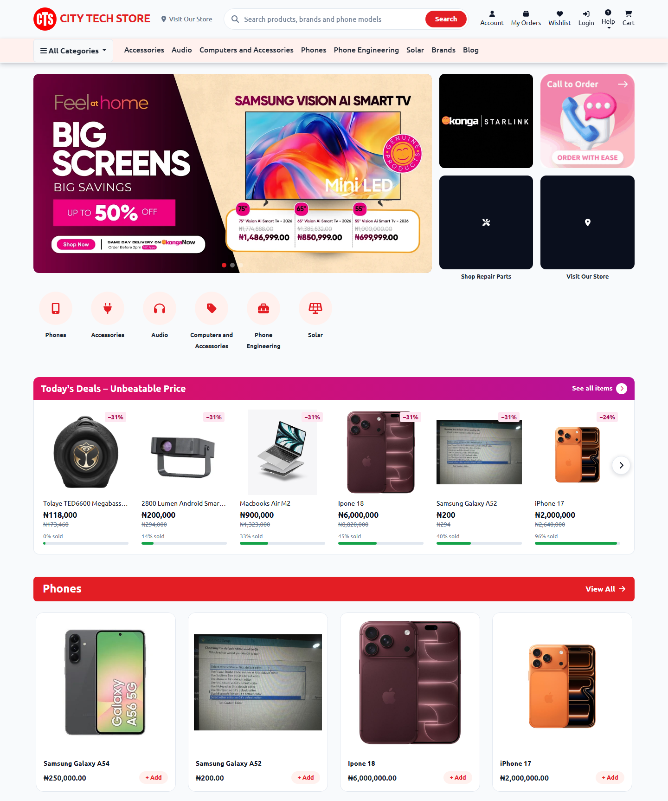
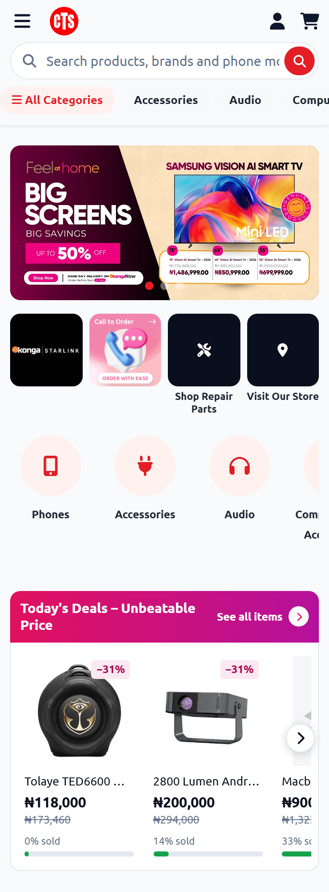
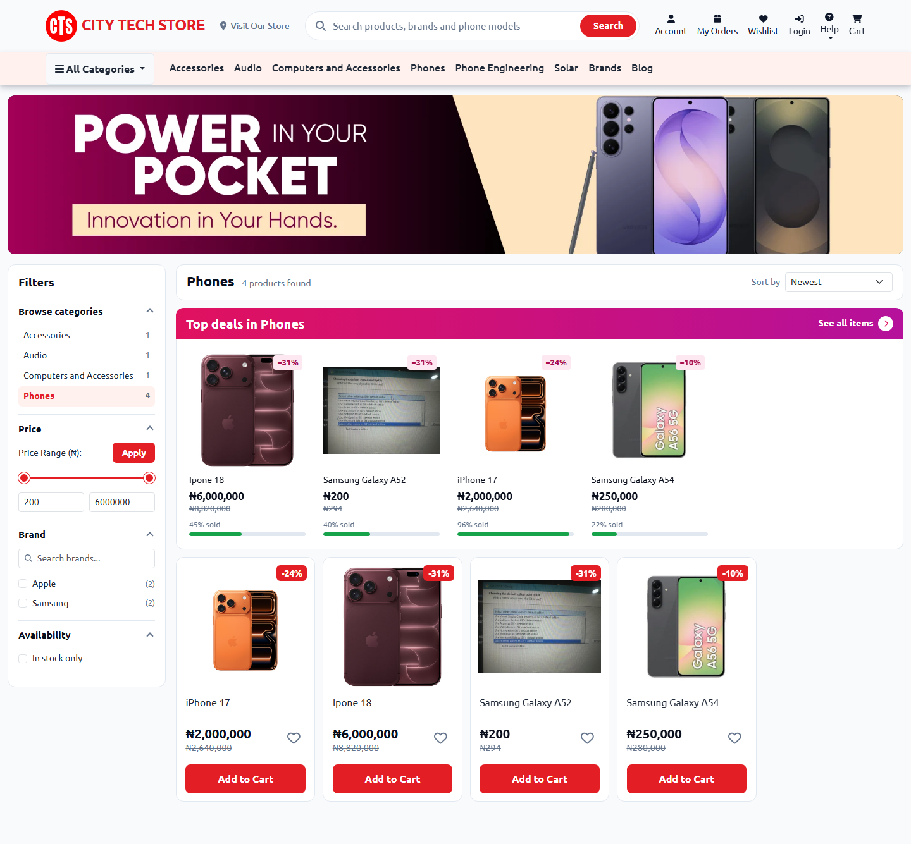
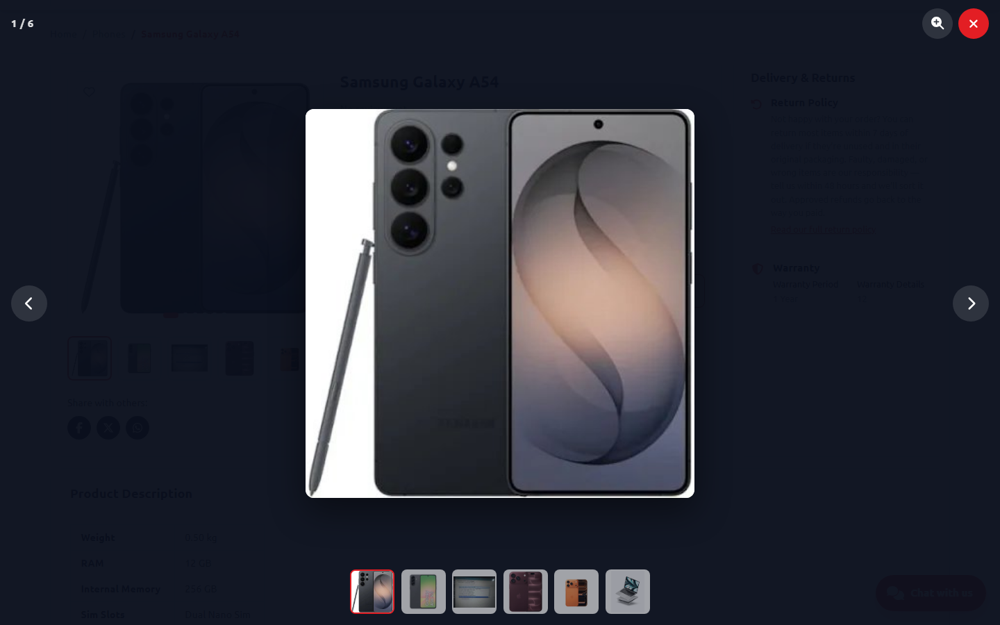
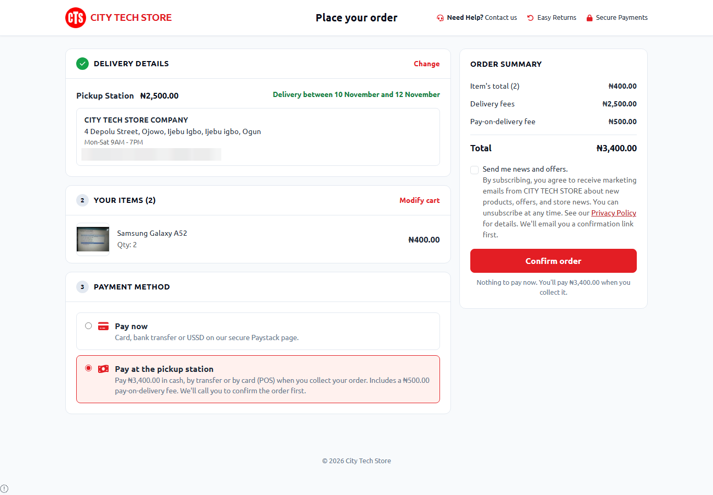
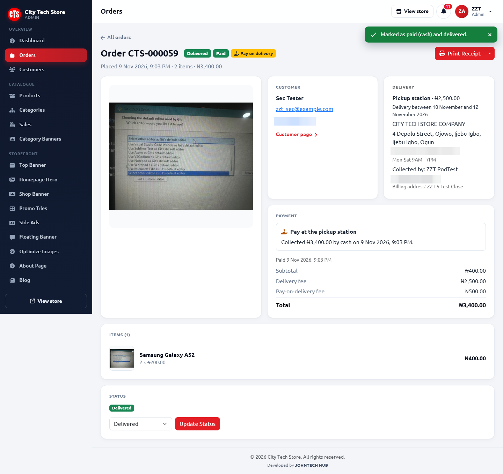
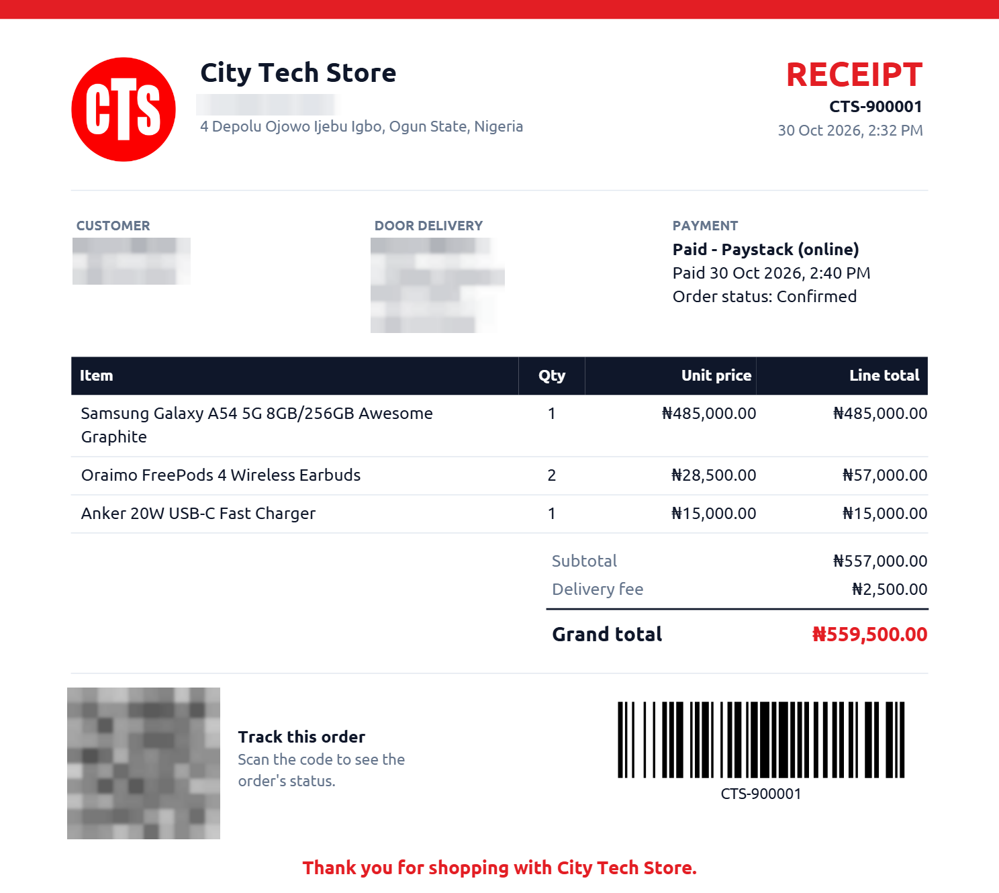
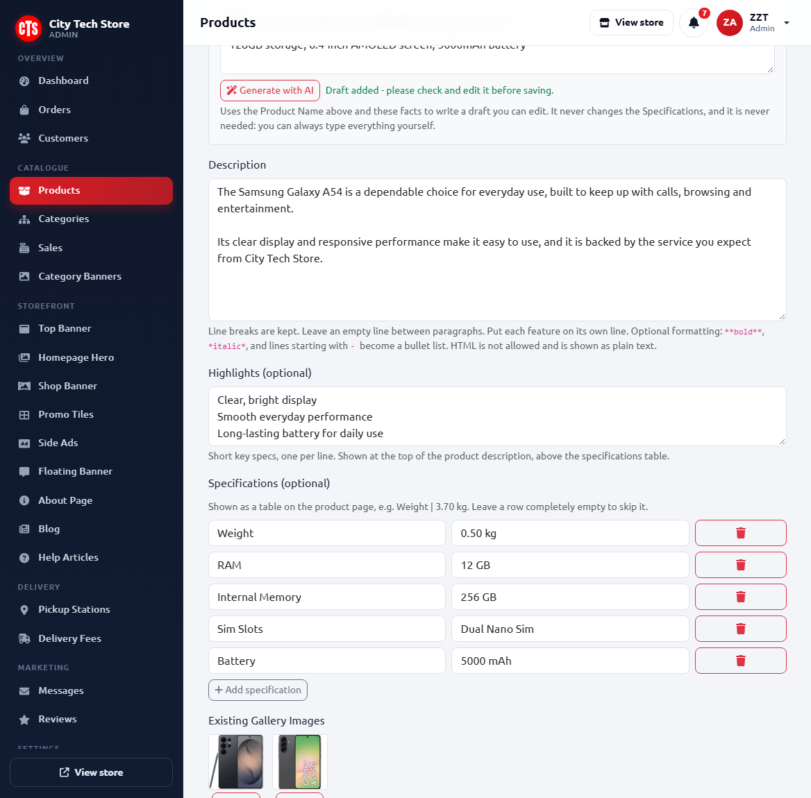
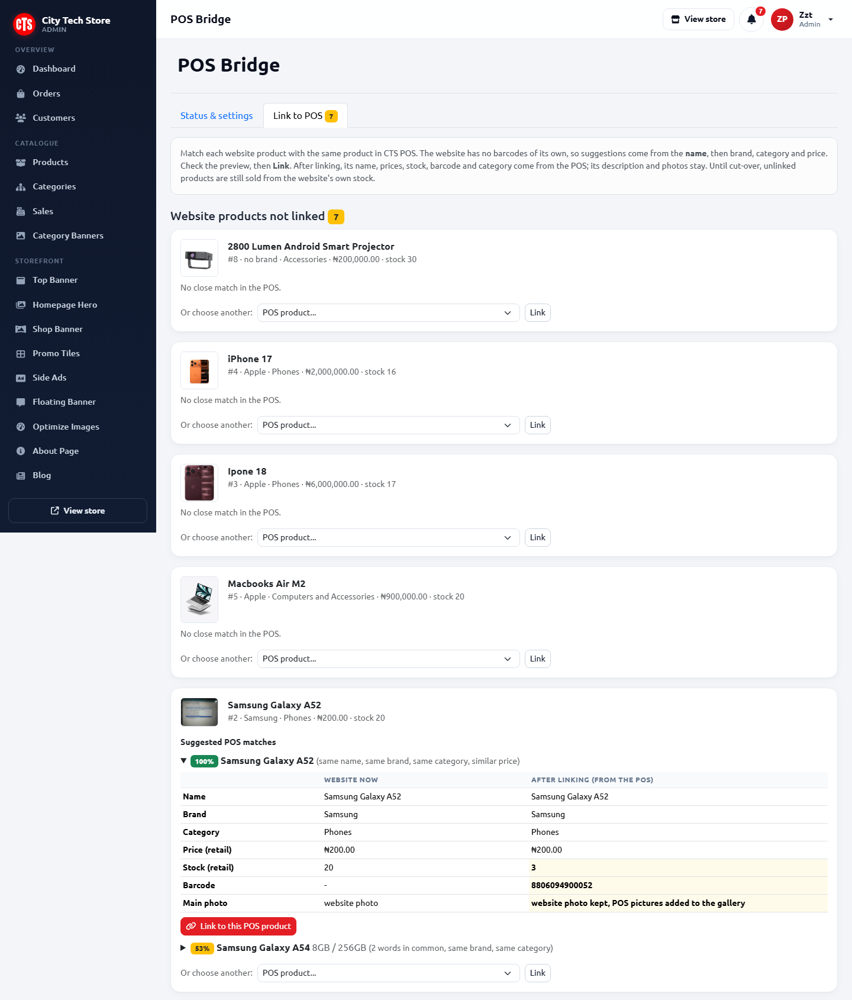

# City Tech Store: online shop

An online store for a phone, electronics and solar shop in Nigeria. Shoppers browse, pay and track orders. Staff run products, orders, marketing and deliveries from one admin area. It runs live on shared hosting; the code is private.

## Main features

- **Storefront:** banners and flash deals, filtered category pages, live search suggestions, zoomable product photos, reviews, wishlist, blog and help centre.
- **Checkout:** pickup-station or door delivery, Paystack payment, order tracking and receipts with a tracking QR code.
- **Accounts:** email or Google sign-in, saved addresses, order history and an inbox.
- **Admin:** sales dashboard, staff roles, product and banner management, newsletter campaigns, review moderation, Excel exports and low-stock alerts.
- **Extras:** AI live chat, AI-drafted product descriptions, a solar sizing calculator and a 3D tour of the shop.

## Tech stack

PHP 8 (custom MVC) · MySQL/MariaDB · JavaScript (jQuery, Chart.js, Leaflet, three.js) · Paystack · Google Sign-In and Analytics · Cloudflare Turnstile · Plunk email · Gemini and Claude APIs · cPanel hosting with cron jobs

## What I built

I took a small existing site (a product list and a staff stock page) and, from September to November 2026, grew it into a full store over about 100 commits. Claude Code, an AI coding assistant, wrote much of the code. I set the requirements, made the design and business decisions, approved every plan and change, and handled releases.

Main challenges solved:

- **Paying once, counting once.** Each payment is confirmed exactly once, whether the customer's return or Paystack's signed webhook arrives first. Missed payments are re-checked hourly; unpaid orders expire.
- **Securing an older codebase.** Fixed an SQL injection and missing login checks. Added CSRF protection, a strict Content Security Policy, bot checks, rate limits and upload checks.
- **Shared hosting limits.** No SSH or Composer on the server, so libraries are bundled by hand and background jobs run on cron.
- **One stock count with the shop's tills.** A link to the shop's point-of-sale system (a separate project) holds items while the customer pays. If a hold runs out and the stock sells, the order is cancelled, the customer is told and staff are prompted to refund.

**Not live yet:** Pay on Delivery and the point-of-sale link are finished and tested on a database copy, but not switched on. The repository has no automated test suite; testing used scripts and browser runs.

## Screenshots

Taken on a test copy: some photos are placeholders and personal details are blurred. Screens 5 and 9 aren't live yet.

